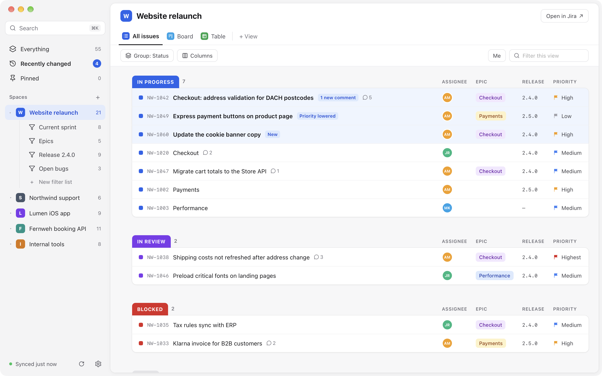
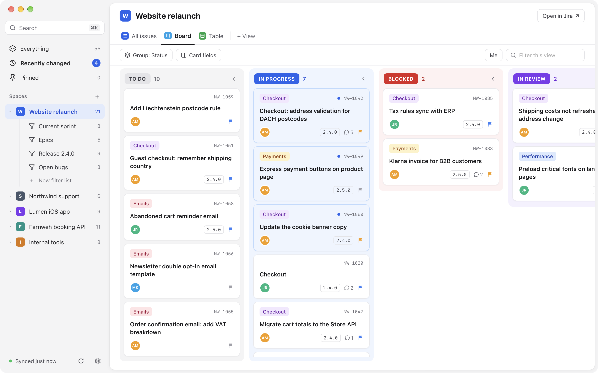
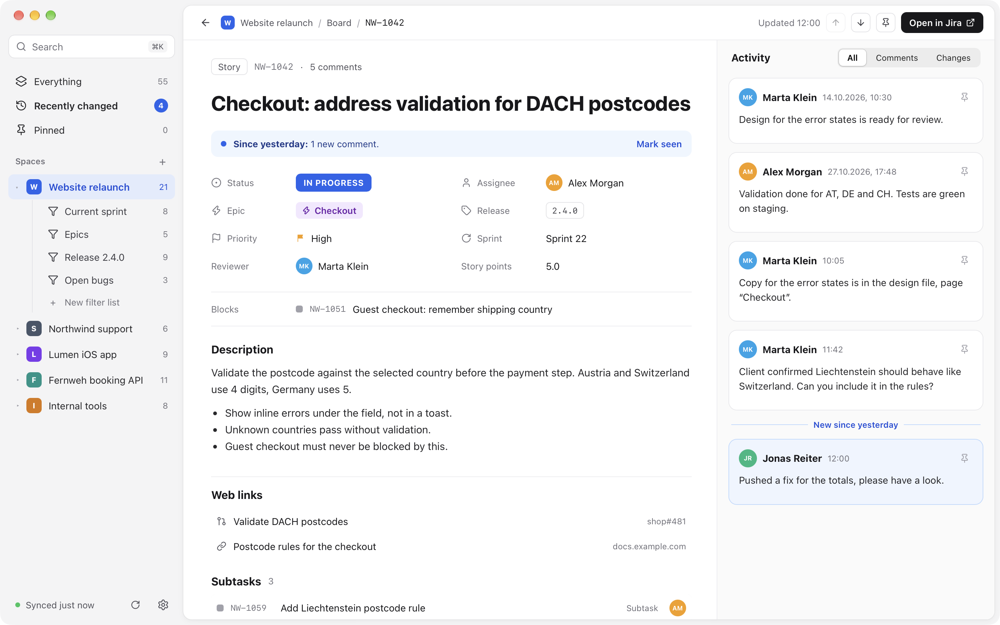
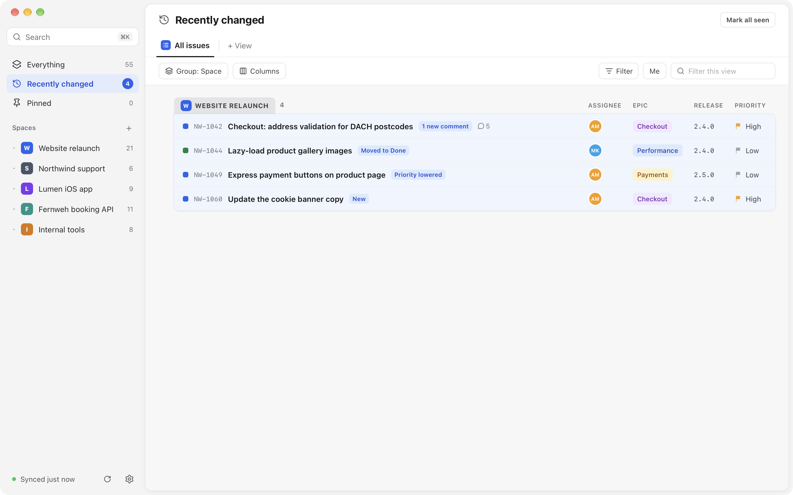
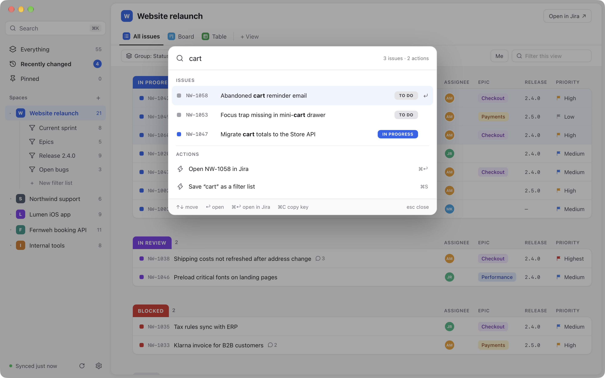
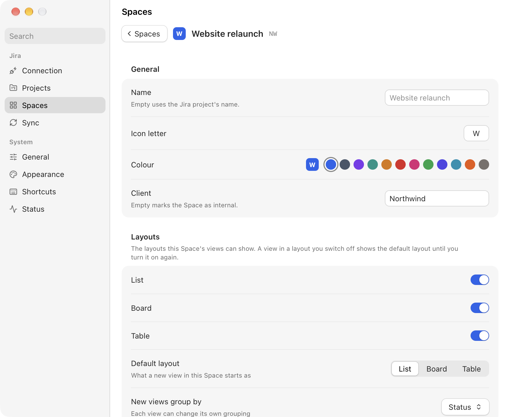
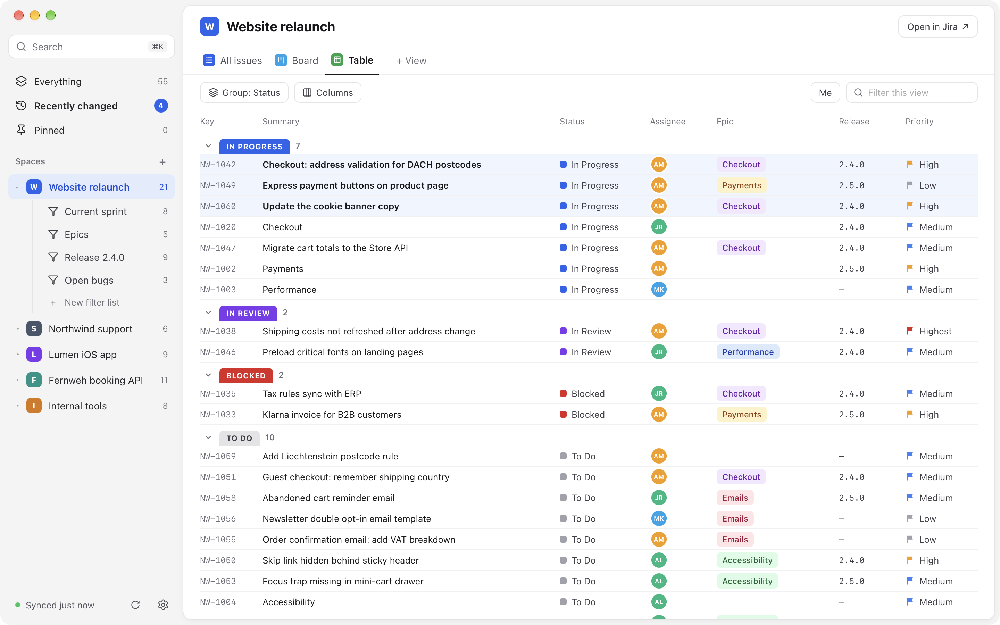

# Taskboard

My task and project manager for macOS: a local-first, read-only Jira Cloud client. It mirrors my Jira issues
into a local SQLite cache and shows them in a fast, native-looking window with Spaces, filter lists and views,
so nothing waits on the network.

It is a local tool for one person on one Mac. Published as source, as-is: no releases, no binaries, no
support. To build it or port it, point a coding agent at [AGENTS.md](AGENTS.md).



## What it does

- **A local mirror of Jira:** a full sync of the chosen projects, then quick change syncs; it works offline
  and shows what is cached. It reads only: nothing is written back to Jira.
- **Spaces, filter lists and views:** each tracked project is a Space with its own filter lists (current
  sprint, open bugs, a release); every list has views as tabs, shown as a List, a Board or a Table, grouped,
  sorted and with their own columns. Filters run locally, so they are instant.
- **Space settings:** per Space, the layouts its views offer and how new views start, its own status colours
  (six status types from Backlog to Done, which views can also group by) and where each custom field shows.
- **What changed:** Recently changed collects new comments, status and assignee changes since you last looked;
  pins keep issues at hand for a while.
- **The Issue view:** description, the filled custom fields (acceptance criteria, steps to reproduce),
  web links (pull requests show as such), related issues and the activity, with Jira's HTML sanitised and
  links opened in the browser.
- **Keyboard first:** ⌘K finds issues by key or text, J/K move, every action has a menu item and a
  rebindable key, and the `taskboard` command line drives the window from scripts.

| | |
|---|---|
|  |  |
|  |  |
|  |  |

All screenshots show made-up demo data from the debug build.

## Privacy

- The API token lives only in the macOS Keychain; it is never written to the settings, the cache or the logs.
- Network traffic goes only to your Jira site and `api.atlassian.com`, through one allowlisted gateway that
  refuses anything but the read requests Taskboard needs.
- The cache stays on your Mac (`~/Library/Application Support/com.philippstracker.taskboard/`). Settings →
  Sync → Cache, File → Reset Cache… or `taskboard reset-cache --yes` empties it.

## Install

```sh
bun install
scripts/create-signing-cert.sh   # once per Mac
bun run release
```

This builds `Taskboard.app`, links it into `~/Applications` and the `taskboard` command into `~/.local/bin`.
It runs on macOS on Apple Silicon only.

## CLI

The `taskboard` command drives the running app the way the window does. It reads and moves around but
never changes Settings, and it never writes to Jira.

| Command | Does |
|---|---|
| `taskboard` | starts Taskboard, or brings the running one to the front |
| `taskboard --hidden` | starts without opening the window; a running instance stays as it is |
| `taskboard --log-level <error\|warn\|info\|debug\|trace>` | overrides the log level for this run |
| `taskboard --version`, `--help` | prints and exits |
| `taskboard show`, `focus`, `hide`, `quit` | shows the window (`focus` also brings it to the front; both start Taskboard if needed), hides it, quits |
| `taskboard status` | the version, the window, where it is (`at: NW Website relaunch › Board`), the sync and each Space's cached and open issues |
| `taskboard open <KEY>` | opens an issue (`NW-12`, any case) in the full Issue view over its Space, starting Taskboard if needed |
| `taskboard spaces` | the tracked Spaces with their ids and keys; `*` marks the open one |
| `taskboard filters [SPACE]` | Everything, Home's lists and every Space's filter lists (`NW/Open bugs`) with their ids and open issues |
| `taskboard views [LEVEL]` | a level's views with their ids and layouts (default: the open level) |
| `taskboard go <LEVEL> [VIEW]` | opens a level at a view, or at the one it showed last; prints where it went |
| `taskboard me [on\|off]` | shows only my issues in the current view; without an argument it flips |
| `taskboard layout <list\|board\|table>` | shows the current view as a list, a board or a table |
| `taskboard search <WORDS…>` | cached issues by key or text, as the command palette finds them |
| `taskboard sync [--full]` | fetches what changed in Jira now (`--full`: every issue of the sync scope); returns at once |
| `taskboard reset-cache --yes` | empties the local copy of Jira and fetches it again; Spaces, filter lists, views and pins stay |

A `LEVEL` is `everything`, `recent`, `pinned`, a Space's key or name, a filter list's name (`KEY/name` when
two Spaces have one of that name) or any id from `spaces` and `filters`. A `VIEW` is a view's name or id. A
unique start of a name is enough. `--json` prints any reply as JSON.

Every command except `show`, `focus`, `open` and `go` needs Taskboard running. Exit codes: 0 ok, 1 Taskboard
refused the request (the reason is printed), 2 bad arguments or "Taskboard isn't running".

```sh
taskboard go NW Board && taskboard me on
taskboard search "login page" --json | jq -r '.[].key'
taskboard status --json | jq .place
taskboard open "$(pbpaste)"
```

## Docs

[docs/README.md](docs/README.md) is the index of the technical documentation.

## License

MIT, see [LICENSE](LICENSE).
