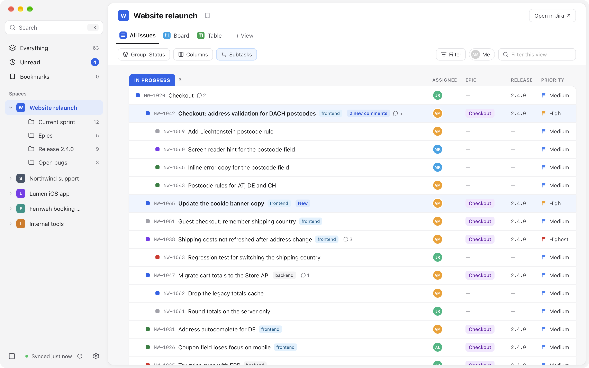
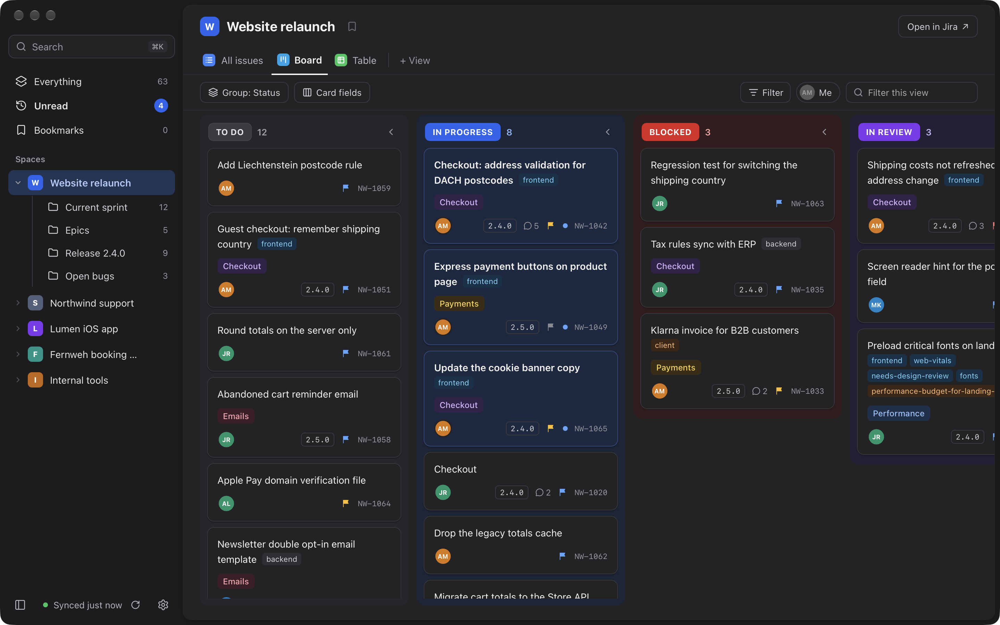
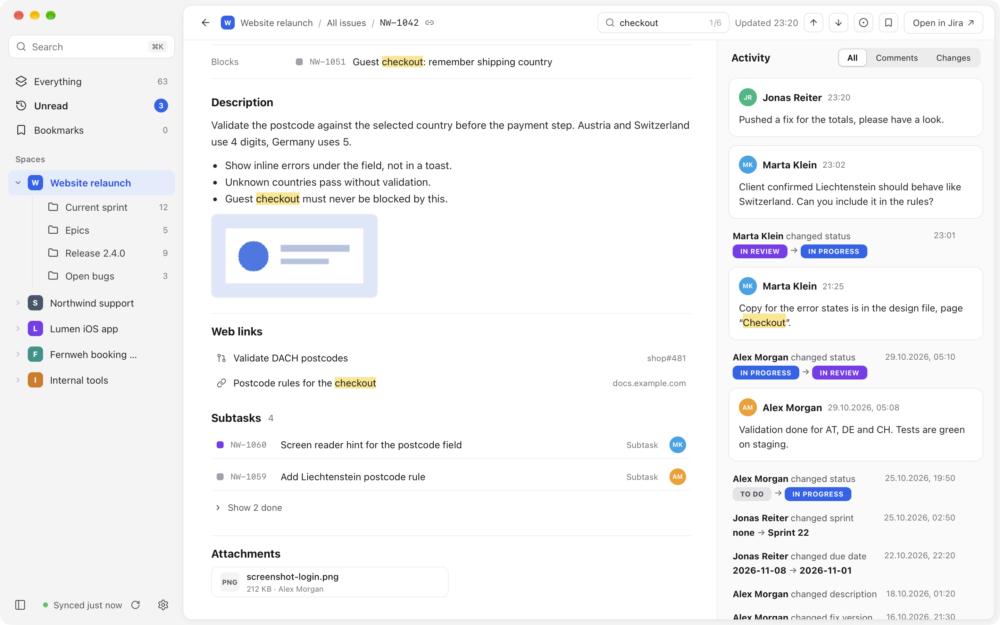
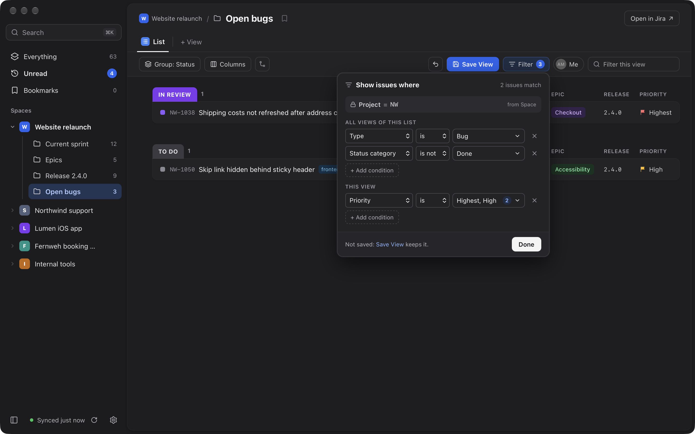
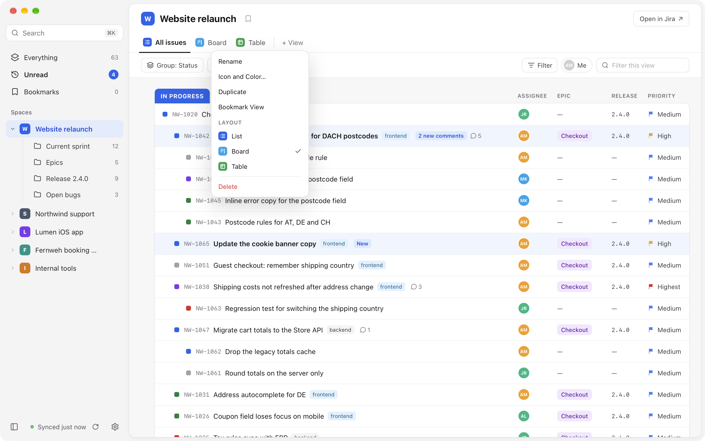
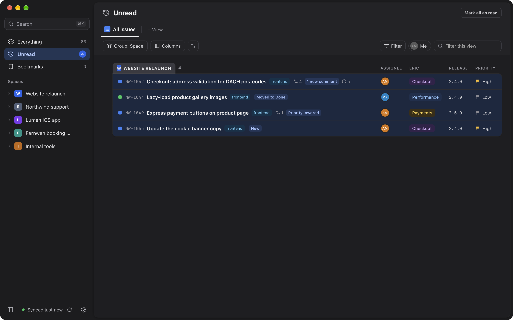
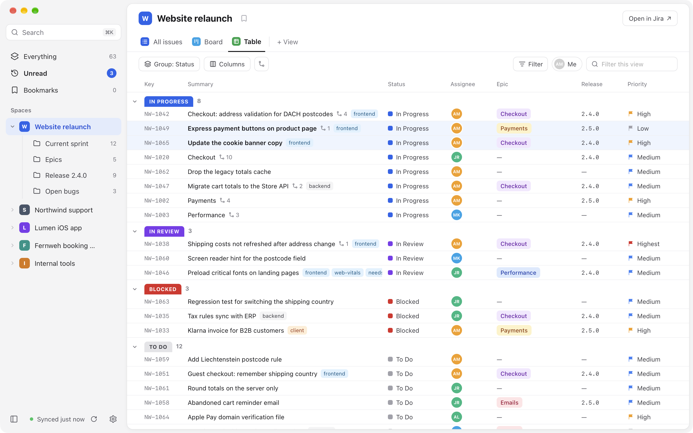
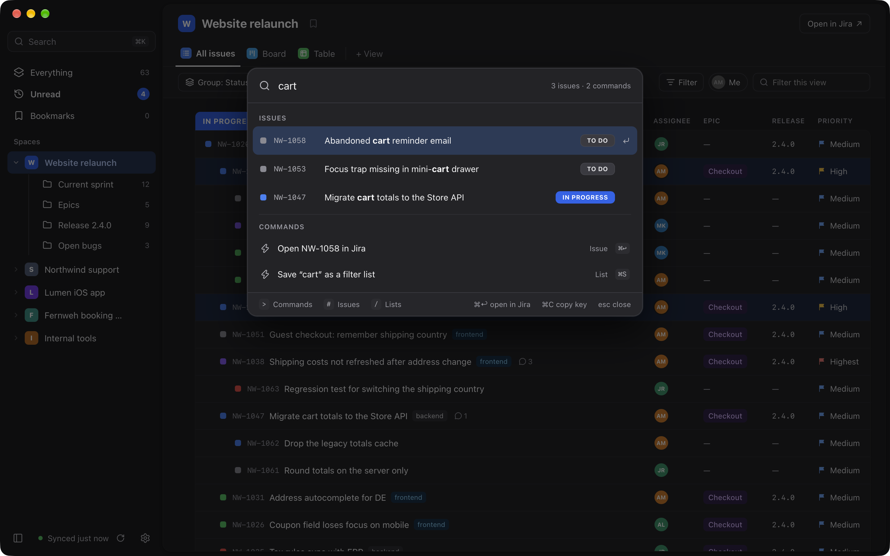
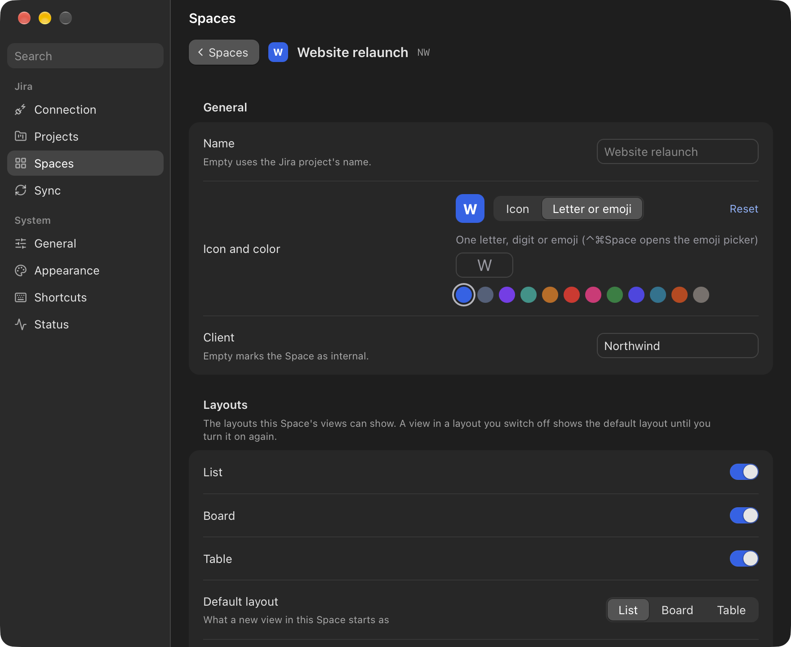

# Taskboard

My task and project manager for macOS: a local-first, read-only Jira Cloud client. It mirrors my Jira issues
into a local SQLite cache and shows them in a fast, native-looking window with Spaces, filter lists and views,
so nothing waits on the network.

It is a local tool for one person on one Mac. Published as source, as-is: no releases, no binaries, no
support. To build it or port it, point a coding agent at [AGENTS.md](AGENTS.md).

<picture>
  <source media="(prefers-color-scheme: dark)" srcset="docs/screens/list-dark.png">
  
</picture>

## What it does

- **A local mirror of Jira:** a full sync of the chosen projects, then quick change syncs; it works offline
  and shows what is cached. It reads only: nothing is written back to Jira.
- **Spaces, filter lists and views:** each tracked project is a Space with its own filter lists (current
  sprint, open bugs, a release); every list has views as tabs, shown as a List, a Board or a Table, grouped,
  sorted and with their own columns, filter, Me chip and subtasks (hidden, under their parent or as rows).
  Filters run locally, so they are instant; changes stay a draft until Save View (⌘S). Spaces, lists and views
  get their own icon and color.
- **Space settings:** per Space, the layouts its views offer and how new views start, its own status colors
  (six status types from Backlog to Done, which views can also group by) and where each custom field shows.
- **What changed:** Unread collects new comments, status and assignee changes since you last looked, and
  anything you mark unread; read marks survive a cache reset. Bookmarks keep issues, comments, lists and views
  at hand, for good or for a while.
- **The Issue view:** description and the filled custom fields (acceptance criteria, steps to reproduce)
  as rich text with inline images, attachments that open in Quick Look, web links (pull requests show as
  such), related issues and subtasks, and the activity: comments and Jira's history, newest first, with
  people's avatars. ⌘F finds words in the open issue and steps through the matches with ↩. A click opens an
  issue in the Preview beside the list or in the full view, per view, a double-click always in the full view;
  ⌥ + hover peeks at any issue. A click on an issue key copies it.
- **Keyboard first:** ⌘K finds issues by key or text and runs any command (`>` commands, `#` issues, `/` Spaces
  and lists), J/K move, every action has a menu item and a rebindable key, right-click menus offer the rest,
  and the `taskboard` command line drives the window from scripts.

| | |
|---|---|
|  |  |
|  |  |
|  |  |
|  |  |

All screenshots show made-up demo data from the debug build.

## Privacy

- The API token lives only in the macOS Keychain; it is never written to the settings, the cache or the logs.
- Network traffic goes only to your Jira site and `api.atlassian.com`, through one allowlisted gateway that
  refuses anything but the read requests Taskboard needs. Profile pictures come from Atlassian's avatar host,
  without credentials.
- The cache stays on your Mac (`~/Library/Application Support/com.philippstracker.taskboard/`). Settings →
  Sync → Cache, File → Reset Cache… or `taskboard reset-cache --yes` empties it; with "Clear the cache when
  Taskboard quits" on, no copy of your issues stays on the Mac after quitting.

## Install

```sh
bun install
scripts/create-signing-cert.sh   # once per Mac
bun run release
```

This builds `Taskboard.app`, links it into `~/Applications` and the `taskboard` command into `~/.local/bin`.
It runs on macOS on Apple Silicon only.

## CLI

The `taskboard` command drives the running app the way the window does. It reads and moves around but
never changes Settings, and it never writes to Jira.

| Command | Does |
|---|---|
| `taskboard` | starts Taskboard, or brings the running one to the front |
| `taskboard --hidden` | starts without opening the window; a running instance stays as it is |
| `taskboard --log-level <error\|warn\|info\|debug\|trace>` | overrides the log level for this run |
| `taskboard --version`, `--help` | prints and exits |
| `taskboard show`, `focus`, `hide`, `quit` | shows the window (`focus` also brings it to the front; both start Taskboard if needed), hides it, quits |
| `taskboard status` | the version, the window, where it is (`at: NW Website relaunch › Board`), the sync and each Space's cached and open issues |
| `taskboard open <KEY>` | opens an issue (`NW-12`, any case) in the full Issue view over its Space, starting Taskboard if needed |
| `taskboard spaces` | the tracked Spaces with their ids and keys; `*` marks the open one |
| `taskboard filters [SPACE]` | Everything, Home's lists and every Space's filter lists (`NW/Open bugs`) with their ids and open issues |
| `taskboard views [LEVEL]` | a level's views with their ids and layouts (default: the open level) |
| `taskboard go <LEVEL> [VIEW]` | opens a level at a view, or at the one it showed last; prints where it went |
| `taskboard me [on\|off]` | shows only my issues in the current view; without an argument it flips |
| `taskboard layout <list\|board\|table>` | shows the current view as a list, a board or a table |
| `taskboard search <WORDS…>` | cached issues by key or text, as the command palette finds them |
| `taskboard sync [--full]` | fetches what changed in Jira now (`--full`: every issue of the sync scope); returns at once |
| `taskboard reset-cache --yes` | empties the local copy of Jira and fetches it again; Spaces, filter lists, views and bookmarks stay |

A `LEVEL` is `everything`, `recent` (Unread), `pinned` (Bookmarks), a Space's key or name, a filter list's name (`KEY/name` when
two Spaces have one of that name) or any id from `spaces` and `filters`. A `VIEW` is a view's name or id. A
unique start of a name is enough. `--json` prints any reply as JSON.

Every command except `show`, `focus`, `open` and `go` needs Taskboard running. Exit codes: 0 ok, 1 Taskboard
refused the request (the reason is printed), 2 bad arguments or "Taskboard isn't running".

```sh
taskboard go NW Board && taskboard me on
taskboard search "login page" --json | jq -r '.[].key'
taskboard status --json | jq .place
taskboard open "$(pbpaste)"
```

## Docs

[docs/README.md](docs/README.md) is the index of the technical documentation.

## License

MIT, see [LICENSE](LICENSE).
